  
   
  <a href="https://damnsunnyy.github.io/Portfolio/buildroom/"><strong>↗ ENTER THE INTERACTIVE 3D BUILDROOM</strong></a>
   Drag the release loop · open real demos · inspect public workflow history

## Shubham Meghani · DevOps / CI/CD

MCA candidate in Pune building a hands-on DevOps foundation through GitHub Actions, CI/CD, release visibility, and dependable web delivery. I bring two months of client-focused web design experience and am looking for entry-level DevOps, CI/CD, or cloud operations opportunities.

**[Portfolio](https://damnsunnyy.github.io/Portfolio/)** · **[Resume](https://damnsunnyy.github.io/Portfolio/assets/Shubham-Meghani-Resume-2026.pdf)** · **[Email](mailto:shubham.meghani.work@gmail.com)** · **[LinkedIn](https://linkedin.com/in/shubham-meghani/)**

The Buildroom is an original, interactive CSS 3D project map. Its workflow panel reads the latest public GitHub Actions runs when opened. GitHub displays the linked artwork as a static preview; click it to enter the rotatable version.

## Projects in the delivery loop

| Project | What it does | Stack and evidence |
| --- | --- | --- |
| [RunScope](https://github.com/damnsunnyy/RunScope) · [Live dashboard](https://damnsunnyy.github.io/RunScope/) | Read-only health dashboard for public GitHub Actions workflows, run duration, and failure patterns | JavaScript, GitHub REST API, GitHub Actions, six metric tests |
| [Portfolio](https://github.com/damnsunnyy/Portfolio) · [Live site](https://damnsunnyy.github.io/Portfolio/) | Responsive portfolio with an automated Pages build and deploy workflow | GitHub Actions, Node.js, GitHub Pages |
| [StreamBox Catalog](https://github.com/damnsunnyy/react-streaming-catalog) · [Live demo](https://damnsunnyy.github.io/react-streaming-catalog/) | Searchable film catalog with a browser-persistent watchlist | React, Vite, GitHub Actions |
| [Todo App](https://github.com/damnsunnyy/TODO-APP) · [Live demo](https://damnsunnyy.github.io/TODO-APP/) | Local browser demo plus a Django REST and SQLite API for local setup | React, Vite, Django REST Framework, SQLite |
| [Apply Desk](https://github.com/damnsunnyy/ApplyDesk) · [Live app](https://damnsunnyy.github.io/ApplyDesk/) | Private job-search workspace for roles, tailored résumés, and application tracking | JavaScript, Supabase, Gmail API |
| [RepoRadar](https://github.com/damnsunnyy/RepoRadar) · [Live demo](https://damnsunnyy.github.io/RepoRadar/) | Searchable map of public GitHub repositories, languages, and stars | JavaScript, GitHub REST API |
| [SiteSentry](https://github.com/damnsunnyy/SiteSentry) · [Live demo](https://damnsunnyy.github.io/SiteSentry/) | Explainable accessibility and discoverability checks for supplied HTML | Python, HTML parser |
| [ModelBench](https://github.com/damnsunnyy/ModelBench) · [Live demo](https://damnsunnyy.github.io/ModelBench/) | Browser-based tabular ML experiments with local data and reproducible reports | Python, JavaScript, scikit-learn |
| [HTML DOM Visualizer](https://github.com/damnsunnyy/HTML-DOM-Visualizer) · [Live demo](https://damnsunnyy.github.io/HTML-DOM-Visualizer/) | Custom HTML parser and searchable DOM tree | JavaScript |
| [Stanford Dog Breed Recognition](https://github.com/damnsunnyy/stanford-dog-breed-recognition) | 120-class image classifier; 66.08% top-1 accuracy on the official test split (single-run baseline) | Python, PyTorch, ResNet-18 |
| [SANA / Echo](https://github.com/damnsunnyy/Echo) | Local-first voice-assistant prototype with speech recognition and a local LLM | Python, FastAPI, React, Electron |
| [RoadTrip](https://github.com/damnsunnyy/RoadTrip) | In-progress iOS prototype for code-based motorcycle group rides | SwiftUI, Firebase, Core Location, MapKit |
| [InsightX](https://github.com/Shubham01-shubh/InsightX) | Collaborator project for exploring and cleaning CSV datasets | React, Django REST |
| [Student Management System](https://github.com/damnsunnyy/StudentManagementSystem) | MERN student directory; requires a configured API and MongoDB | React, Express, MongoDB |

## Tools I’m practicing

`Git` · `GitHub Actions` · `CI/CD` · `Node.js` · `JavaScript` · `Python`  · `REST APIs` · `React` · `Django REST` · `PyTorch` · `Java` · `MongoDB`

## Find me

- [Portfolio](https://damnsunnyy.github.io/Portfolio/)
- [GitHub repositories](https://github.com/damnsunnyy?tab=repositories)
- [LinkedIn](https://linkedin.com/in/shubham-meghani/)
- [Email](mailto:shubham.meghani.work@gmail.com)

Build clearly · ship carefully · learn in public

