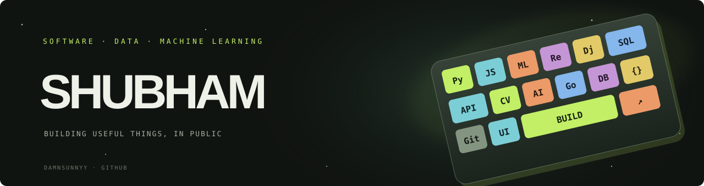

  

## Hi, I’m Shubham Meghani

I build across machine learning and full-stack development. My projects range from a PyTorch dog-breed classifier and Java resume matcher to browser-based data tools, an on-device voice assistant, and a native group-riding app.

**Portfolio:** [damnsunnyy.github.io/Portfolio](https://damnsunnyy.github.io/Portfolio/) · **Projects:** [Browse all repositories](https://github.com/damnsunnyy?tab=repositories)

### Recent projects

| Project | What it does | Built with |
| --- | --- | --- |
| [RepoRadar](https://github.com/damnsunnyy/RepoRadar) | Maps public GitHub projects, languages, and stars into a searchable profile explorer | JavaScript, GitHub REST API |
| [SiteSentry](https://github.com/damnsunnyy/SiteSentry) | Crawls public sites carefully and explains baseline accessibility and discovery findings | Python, HTML parser |
| [ModelBench](https://github.com/damnsunnyy/ModelBench) | Compares tabular ML models with leakage-safe pipelines and reproducible holdout/CV reports | Python, pandas, scikit-learn |
| [InsightX](https://github.com/Shubham01-shubh/InsightX) | Collaborator project: explore and clean CSV datasets in a browser-based workspace | React, Django REST |
| [Stanford Dog Breed Recognition](https://github.com/damnsunnyy/stanford-dog-breed-recognition) | Fine-grained image classification across 120 dog breeds | PyTorch, ResNet-18 |
| [DocsFlow](https://github.com/damnsunnyy/google-docs-clone) | Real-time collaborative document editor | MERN, Socket.IO |
| [Echo](https://github.com/damnsunnyy/Echo) | Local-first voice assistant with a live dashboard | Python, Faster Whisper, Ollama, React, Electron |
| [RoadTrip](https://github.com/damnsunnyy/RoadTrip) | SwiftUI motorcycle group-riding prototype with shared location | SwiftUI, Firestore, MapKit |
| [HTML DOM Visualizer](https://github.com/damnsunnyy/HTML-DOM-Visualizer) | Interactive custom HTML parser and searchable DOM tree | JavaScript |
| [Student Management System](https://github.com/damnsunnyy/StudentManagementSystem) | MERN student directory with search, filters, CRUD, and export | React, Express, MongoDB |

### Tools I use

`Python` · `PyTorch` · `scikit-learn` · `JavaScript` · `React` · `Django REST` · `Java` · `Spring` · `Node.js` · `SQLite` · `SwiftUI` · `Firebase` · `Electron` · `MongoDB`

### Find me

- [Portfolio](https://damnsunnyy.github.io/Portfolio/)
- [GitHub repositories](https://github.com/damnsunnyy?tab=repositories)
- [LinkedIn](https://linkedin.com/in/shubham-meghani/)
- [Email](mailto:shubham.meghani95@gmail.com)

---

Building useful software, one thoughtful iteration at a time.

